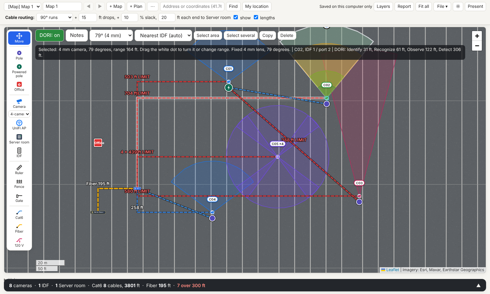
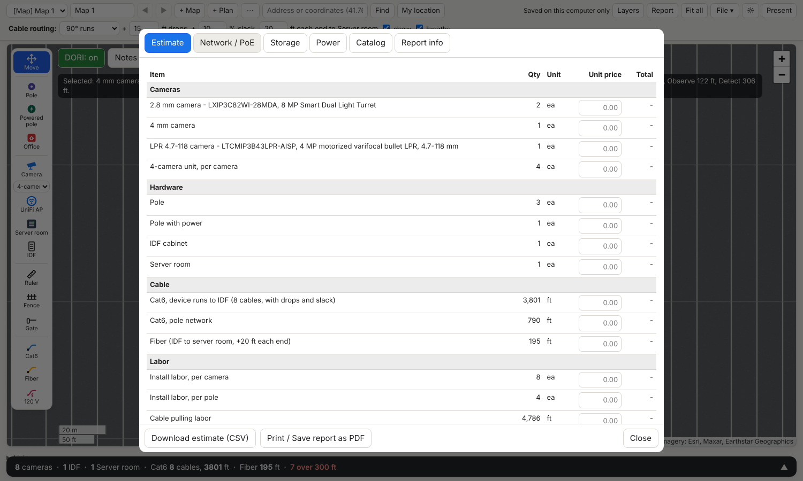
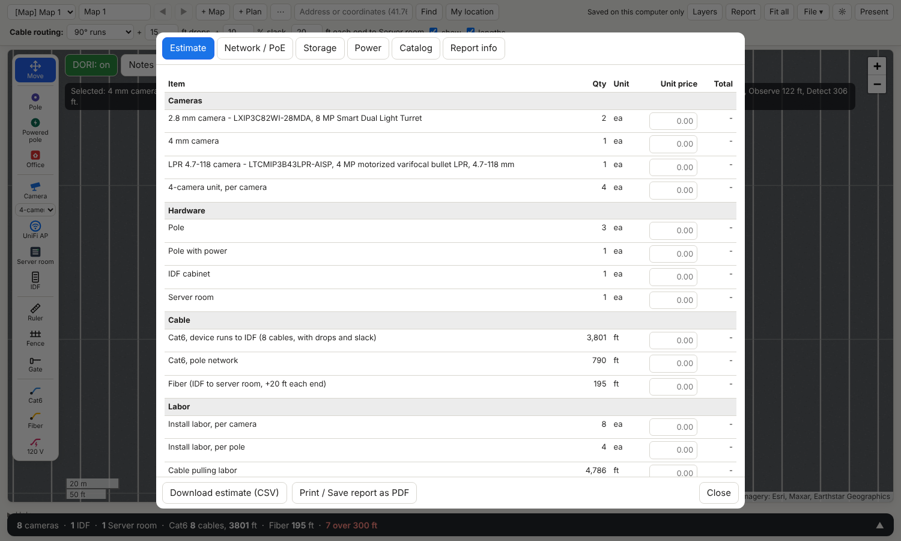

# CCTV Camera Planner

**Free CCTV / IP security camera placement planner.** Draw cameras, poles, IDFs and cable runs on a satellite map or a floor plan, see field of view and DORI coverage, check PoE and cable-length limits, and export a priced estimate and a client-ready PDF report. Single HTML file, no server, no account. Also available as a portable Windows `.exe`.



Keywords: CCTV design tool, security camera layout, camera field of view calculator, DORI calculator, video surveillance site survey, PoE budget, Cat6 cable length, IP camera bill of materials, camera pole planner.

## Features

- **Satellite map or floor plan.** Use the Esri satellite layer, or import a floor plan (image or PDF) and calibrate the scale.
- **Camera placement with real coverage.** Fixed lenses (2.8, 4, 6, 8, 12 mm), varifocal, 360° fisheye, 4-camera multi-sensor, PTZ and LPR cameras. Each lens gets its own zone color. Drag the handle to rotate or change range. Click a zone to select its camera, even when several cameras share one pole.
- **DORI.** Identify / Recognize / Observe / Detect distances per camera (250 / 125 / 62.5 / 25 px per meter), based on the sensor resolution.
- **Infrastructure.** Poles, powered poles, offices, server rooms, IDF cabinets, UniFi-style access points, fences, gates, rulers, cubicles (any shape, editable sides).
- **Cables.** Cat6, fiber and 120 V power. Routing options (90° runs, drops, slack, end allowances). Runs over 300 ft (Cat6 limit) are flagged.
- **Network / PoE.** Auto-assign cameras to the nearest IDF, switch port numbering, PoE budget per switch.
- **Storage.** Estimate disk space from bitrate, codec, days and number of cameras.
- **Power.** 120 V circuit summary.
- **Estimate / BOM.** Quantities from the drawing, editable unit prices and labor, CSV export.
- **Client report.** Print or save a PDF with your logo, cover info, map snapshot, camera schedule and estimate.
- **Camera library.** Axis and Hikvision models with specs taken from the manufacturer datasheets (source link shown for each). Add them to your camera list in one click.
- **Mount height and tilt.** Enter height and tilt for a camera to see the real ground coverage and the blind zone at the pole base.
- **Lens helper.** Distance plus Identify / Recognize / Observe / Detect gives the widest view that still works and the models that can do it.
- **Switch and recorder per IDF.** Pick a switch and an NVR, get warnings for ports, PoE budget, channels, bandwidth and disk size.
- **Voltage drop** for 120 V runs, **fixes for Cat6 runs over 300 ft** (fiber with media converters or PoE extender, added to the estimate) and an automatic **network diagram**.
- **Layers, notes, photos** attached to objects, **custom cameras** with your own model and specs.
- **Multiple maps and plans** per project, undo/redo, copy/paste, select area, present mode, dark mode.
- Data is saved locally in your browser (or in the desktop app).




## Use it

### Option 1: in the browser
Open `index.html` (or the GitHub Pages site for this repo). Nothing to install.

### Option 2: Windows portable app
Download `CCTV-Camera-Planner-<version>.exe` from the **Releases** page and run it. No installer.
It is not code-signed, so Windows SmartScreen may warn: click **More info → Run anyway**.
"My location" uses the native Windows location service (turn on Location in Windows settings).

### Option 3: build the app yourself
```bash
cd electron
npm install
npm run dist        # outputs electron/dist/CCTV-Camera-Planner-1.0.0.exe
npm start           # run without packaging
```
Needs Node.js 18+. Building the Windows target on Linux or macOS works without Wine.

## Quick start

1. Search an address or press **My location**.
2. Pick **Pole**, click the map. Pick **Camera**, choose a lens, click the pole.
3. Drag the white dot on the zone to aim and set range. Turn on **DORI** to see detail distances.
4. Add an **IDF** and **Server room**, then draw **Cat6** from cameras to the IDF and **Fiber** from IDF to server room.
5. Open **Report** for estimate, network/PoE, storage and the PDF.

Shortcuts: right-click switches to Move, Esc closes panels, Ctrl+Z / Ctrl+Y undo/redo, Ctrl+C / Ctrl+V copy/paste.

## Assumptions and limits

- Coverage is geometric (lens field of view and range), not a photometric simulation. Real results depend on lighting, mounting height and angle.
- DORI uses the common 250/125/62.5/25 px/m thresholds; sensor widths are 3840 px (8 MP) and 2688 px (4 MP).
- Cat6 limit is 300 ft (about 100 m) including drops and slack. Fiber has no limit check.
- Satellite imagery is loaded from Esri and needs internet. IP-based location is approximate.
- Prices in the estimate start at zero: enter your own.
- Cloud sync and auto-update are not included.

## Tech

Plain HTML/JS, [Leaflet](https://leafletjs.com/), [pdf.js](https://mozilla.github.io/pdf.js/). Desktop app: Electron + electron-builder.

## License

MIT, see [LICENSE](LICENSE). Made by DAGTECH.
